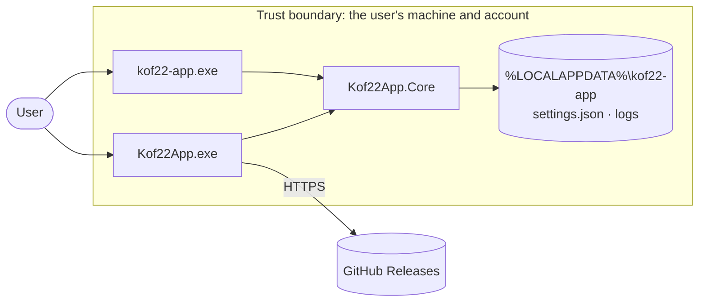

# Threat model: Kof22 App

<!-- K22-SDLC-03. Update in any pull request that changes the attack surface, and review
     in every MINOR/MAJOR release checklist (K22-SEC-30). Method: data flow + STRIDE. -->

- **Version reviewed:** template readiness work · **Last reviewed:** 2026-10-10

## 1. What the product is and does

A Windows desktop application installed per user (no administrator rights) with
Velopack, updating itself from its GitHub Releases. It runs entirely on the user's
machine: it keeps preferences and logs in the user's profile and has no server
component. The template's example feature (a greeting) handles only text the user types.

## 2. Actors and components

| Actor or component | Description | Trust level |
| --- | --- | --- |
| User | The person running the app | Trusted for their own data |
| WinUI shell (`Kof22App.exe`) | Views and startup plumbing | Runs as the user |
| Core (`Kof22App.Core`) | Logic, settings, view models | Runs as the user |
| Command line (`kof22-app.exe`) | Optional scriptable head over Core | Runs as the user |
| AppKit packages | Shell services: logging, settings, secrets, updates, splash, About | Third-party code, pinned and attested |
| Velopack update service | Checks GitHub Releases, downloads and applies packages | Runs as the user |
| GitHub Releases | Update feed and download source | Untrusted network data |

## 3. Data flow and trust boundaries

## 4. External interfaces

| Interface | Direction | Data | Authenticated? | Validated where? |
| --- | --- | --- | --- | --- |
| Window input (text boxes, menus) | In | User text | The signed-in user | `GreetingService.Greet` (length limit), each feature's Core service |
| Command line arguments | In | Command, options | The signed-in user | `CliApp.Run` (unknown commands and options rejected) |
| `settings.json` | In/out | Preferences | File ACLs of the user profile | `SettingsStore` sanitizes on load; corrupt files fall back to defaults |
| Log files | Out | Operational events, no secrets | File ACLs | Logging API takes messages only |
| Data-folder environment variable | In | A folder path | The signed-in user | Used as a path only |
| Update feed (GitHub Releases over HTTPS) | In | Release metadata and packages | TLS; package hashes checked by Velopack | Velopack |
| Windows Credential Manager | In/out | Secrets, if a feature stores any | The user's Windows login | AppKit `CredentialManagerVault` |

## 5. Assets

The integrity of the installed program and its updates (an attacker who controls them
runs code as the user), the user's preferences and any stored secrets, and availability
of the app.

## 6. Threats (STRIDE)

| # | Boundary / component | Category | Threat | Likelihood | Impact | Mitigation | Status |
| --- | --- | --- | --- | --- | --- | --- | --- |
| T1 | Update feed | Tampering | A malicious update is served to installed copies | Low | Critical | Updates only from this repository's immutable, attested GitHub Releases over HTTPS; Velopack verifies package hashes; Authenticode signing once EX-0002 closes | Mitigated (signing pending) |
| T2 | Download | Spoofing | A tampered installer on a mirror | Medium | High | README verification steps: `SHA256SUMS`, `gh attestation verify`, Authenticode | Mitigated |
| T3 | Settings file | Tampering | A crafted `settings.json` crashes the app or sets invalid values | Low | Low | Source-generated deserialization, `Sanitize` on load, defaults on failure | Mitigated |
| T4 | Logs | Information disclosure | Secrets or personal data written to logs | Low | Medium | Log calls take plain messages; secrets go only to Credential Manager (K22-SEC-71); review | Mitigated |
| T5 | Install folder | Elevation of privilege | DLL planting next to the exe | Low | High | Per-user install under `%LOCALAPPDATA%`, owned by the user; no loading from the working directory | Mitigated |
| T6 | Shell | Denial of service | An unhandled exception closes the app with unsaved work | Medium | Low | AppKit crash net logs and survives UI exceptions; one-dialog-at-a-time guard | Mitigated |
| T7 | Input | Denial of service | Very long input slows or breaks the UI | Low | Low | Length limits in Core services | Mitigated |
| T8 | Repository administration | Tampering | Setup weakens protections, trusts another check producer or targets another repository | Low | High | Offline preview; exact public target/admin checks; verify official Actions identity and every context binding in apply/readback; current-PR checks; refuse conflicting rules and broad release refs; preserve reviewed plan | Local regression tests pass; live bootstrap pending |
| T9 | PR review workflow | Elevation of privilege | Untrusted PR code runs with a checks write token | Low | High | Comment-triggered workflow executes trusted workflow SHA only; no PR checkout; human current-SHA acknowledgement required | Local tests pass; hosted enforcement pending |
| T10 | Package-manager distributions | Tampering | Manifest points at wrong bytes or an unsafe executable | Low | High | Stable-only generation; ZIP identity/layout checks; actual SHA256 and provenance verification; exclude helper shims; candidate review before feed publication | Local tests and real archive/schema checks pass; feed lifecycle pending |
| T11 | Installed update smoke | Tampering | A test overwrites a real app or deletes unrelated files | Low | Medium | Unique test package ID; fresh artifacts-only output; app identity check; literal arguments; offline URL allowlist; exact process path; root/manifest checks before uninstall | Local runtime/boundary tests pass; hosted CI pending |

## 7. Accepted risks

- EX-0002 tracks historical unsigned Windows release risk. The current application
  release preflight rejects unsigned production publication. Verified deployment,
  scoped CI authorization and final-artifact signature acceptance remain required;
  completed publisher validation alone does not prove CI signing.

## 8. Review log

| Date | Version | Reviewer | Changes |
| --- | --- | --- | --- |
| 2026-10-09 | template baseline | maintainer | Initial model from the Windows desktop reference architecture |
| 2026-10-10 | repository setup | Codex (GPT-6) | Added administration and review workflow trust boundaries; live proof pending |
| 2026-10-10 | check producer readback | Codex (GPT-6) | Verify official Actions identity/bindings without mutating caller plans; clarify signing gate versus historical risk |
